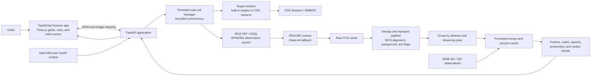

## NASA Space Apps - Before & Beyond
#### Arush, Aditya Gaur, Nishad Mulay, Sristi Sharma


**Explore how a patch of infrared sky changes over time and test whether a source follows a chosen motion.**

SPHEREx Time Cube is a public, no-login tool for viewing aligned SPHEREx images of one sky region as a timeline and interactive 3D cube. Use shift-and-stack to test a trial motion. Separately labeled WISE observations extend the timeline for selected examples.

<div align="center">

[Launch the live app](https://spherex-time-cube-8pnr.onrender.com/?scene=globe&job=9032b93d074019135315&ra=133.8189&dec=-7.2470&fov=0.20&axis=time&group=3&t=0&vx=0&vy=0&view=colour&gaia=1&static=median&px=109&py=29&panel=spectrum&a=0&b=11) · 
[Watch the demo](REPLACE_WITH_PUBLIC_DEMO_LINK) · 
[View the source code](https://github.com/Sristi-SS/Before-and-Beyond-2026-NASA-Space-Apps)
</div>

## About the challenge

NASA Space Apps **Planet X and SPHEREx** challenge asks for a public tool that makes it easier to explore how SPHEREx sky images change over time. SPHEREx observes the sky in 102 near-infrared bands, and observations from different times can reveal sources that move or vary. Because wavelength varies with position in a SPHEREx image, comparisons also need to keep the image position and wavelength information straight. 
<div align="center">

[Challenge description](https://www.spaceappschallenge.org/2026/challenges/planet-x-and-spherex/) · [IRSA SPHEREx overview](https://irsa.ipac.caltech.edu/onlinehelp/spherex/spherex/overview.html)

</div>

---
## Overview

SPHEREx Time Cube is a public, browser-based tool for exploring how infrared observations of the same region of sky change over time. It brings archival SPHEREx images together in an interactive timeline and 3D time cube, making it easier to compare observations and inspect changes across epochs. Users can browse aligned images, compare frames, and shift-and-stack observations under a trial motion to examine possible moving sources. Optional Gaia overlays and separately labeled WISE observations provide additional context. 

---
## Features


---
## Technology Stack

| Layer | Technology | Role |
|---|---|---|
| Frontend | TypeScript, Node.js 22, Vite 6, Three.js | Builds the browser interface and renders the sky globe, time cube, and orbit scene. |
| Browser graphics | HTML, CSS, Canvas 2D, WebGL | Provides controls, 2D plots, and image rendering. |
| Backend API | Python 3.14, FastAPI, Uvicorn, Pydantic | Serves the API and built frontend, validates requests, and manages cube jobs. |
| Astronomy processing | Astropy, PyVO, `reproject`, NumPy, SciPy | Reads FITS/WCS metadata, searches archives, aligns images, and runs image and motion analysis. |
| Contact sheets | Matplotlib Agg | Renders labeled frame summaries without a desktop display. |
| Data services | IRSA TAP/ADQL, IBE/DataLink, CDS Sesame/SIMBAD, Gaia DR3, VizieR, WISE W1/W2 | Finds observations, resolves names, and adds separately identified catalog or survey context. |
| Cache | On-disk FITS, NumPy arrays, and JSON job state | Reuses downloaded products and completed cube builds. |
| Packaging | Docker and a Render blueprint | Describes the deployment target; the deployment notes mark it as untested. |


---
## System Architecture 



1. The browser sends a target name or coordinates and cube settings to the API.
2. The backend resolves the target, searches IRSA for SPHEREx detector planes, and retrieves FITS cutouts with their WCS and quality layers. Raw products are cached on disk.
3. The processing pipeline aligns valid pixels to a common sky grid, subtracts zodiacal light and a robust median background, applies the documented flag mask, and groups frames by detector and observing pass.
4. Job metadata and processed arrays are persisted in the cache. WISE observations remain separately identified; Gaia and VizieR results provide catalog context.
5. The API serves the frames and analysis products to the browser, where the globe, 3D cube, comparisons, spectrum panels, and motion views are rendered.


---
## Data sources and Scientific Processing

### How a cube is made
 1. **Resolve the position.** The five challenge targets come from a built-in
   table (values read from CDS Sesame/SIMBAD on 2026-11-13), so they need no
   network. Other names go through CDS Sesame. All are treated as J2000
   coordinates with a proper motion.
   Named cubes are centred on the position **propagated to 2026.5**, the middle
   of the SPHEREx survey; otherwise Barnard's Star sits about 4.5 arcmin off-centre (26 yr x 10.36 arcsec/yr = 269 arcsec).
   Explicit coordinates are used exactly as entered.
2. **Search the archive.** A TAP `ADQL` cone search on `spherex.obscore`
   One row is returned per detector plane. The search returns planes from
   every collection (`spherex_dr1`, `spherex_qr3`, `spherex_dr1_deep`); the
   cached cubes mix them. When two collections hold the same exposure, only
   one copy is kept (`spherex_dr1` first). Each frame records its collection.
3. **Fetch cut-outs.** IRSA IBE cut-outs (`?center=RA,DEC&size=DEG`) give the
   `IMAGE`, `FLAGS`, `VARIANCE` and `ZODI` layers plus a celestial WCS and a
   `WAVE-TAB` WCS. If IBE cannot serve a plane, the DataLink link is used as a
   fallback. Raw FITS files are cached under `data/cache/raw/`.
4. **Align.** Every image is reprojected onto one north-up TAN grid
   (default 128 × 128 px at 6.15 arcsec/px, so the grid is 787 arcsec = 0.22 deg wide).
   Native SPHEREx pixels are 6.15 arcsec; the tool never upsamples by more than 2×.
   The "field of view" choice only sets the size of the cut-out requested from the
   archive (never smaller than the grid needs); it does not resize the grid.
5. **Clean.** The ZODI layer and a robust median background are subtracted.
   `FLAGS` is masked except bit 21 (`SOURCE`, "pixel mapped to a known source")
   and bit 12 (`FULLSAMPLE`); every other bit is treated as contamination. The
   bit names come from the `MSKNnnnn` keywords in the FLAGS header. Masked
   pixels inside the detector outline (saturated star cores, bad pixels) are
   filled by interpolation from their neighbours, so a bright star is not a
   black hole; do not measure fluxes there. The masked fraction and coverage
   are stored per frame and shown in the UI.
6. **Group.** Frames are clustered into passes by a 60-day gap, then split by
   detector (the six wavelength groups). Frames in the same pass and detector
   are averaged into one slice for the pass-averaged cube; the 3D view uses the
   individual aligned epochs so the real cadence is visible.
7. **Tilt.** For a trial velocity `(vx, vy)` in arcsec/yr, each frame is shifted
   by `v · Δt / pixel scale` and summed. Cubic interpolation (`ndimage.shift`,
   order 3) is used because bilinear interpolation biased the recovered
   velocity by 1.5 arcsec/yr on the Barnard's Star test cube. The score is the
   peak of the smoothed, flux-averaged stack.

*Orientation: the grid is north-up with a negative RA step, so east is −x and north is +y. A positive `vx` therefore moves a source toward smaller x.
*As new SphereX data becomes available, Time Cube can update according to that data  

### Detector wavelength groups

| Group | Nominal range (µm) | Typical λ in the cube |
| --- | --- | --- |
| D1 | 0.75–1.12 | 0.75–0.90 |
| D2 | 1.10–1.65 | 1.20–1.60 |
| D3 | 1.63–2.43 | 1.65–2.36 |
| D4 | 2.40–3.85 | 2.50–3.80 |
| D5 | 3.81–4.43 | 3.85–4.40 |
| D6 | 4.41–5.01 | 4.45–4.95 |

The exact wavelength of each frame is read from the `W` (`WAVE-TAB`) WCS, so it
varies within a detector and is displayed per slice.

---
## Installation (Windows, Python 3.14, Node 22)

```bat
python -m venv .venv
.venv\Scripts\activate
pip install -r requirements.txt

npm --prefix frontend install
npm --prefix frontend run build

python -m backend.app
:: open http://127.0.0.1:8000
```

For live frontend work, `npm --prefix frontend run dev` serves
`http://127.0.0.1:5173` and proxies `/api` to the backend on port 8000.

Build a cube from the UI, or warm the cache from the command line:

```bat
python -m backend.precache --only barnard --max-frames 40
python -m backend.precache --only epsindb,wise0855,rwaur,rdra --max-frames 40
python -m backend.precache --force      :: all five, rebuilt from the archive
```

The pre-cache writes `data/precache_summary.json` (merging with earlier runs)
and a `contact_sheet.png` per target. The cubes the page opens from the globe
are the 40-frame builds of 2026-11-14 (see the table under "The five challenge
objects"); smaller 12- and 20-frame cubes from earlier runs are still in the cache.
`data/precache_summary.json` was written by an earlier, smaller run and is not the
source of the numbers in this README; those come from `job.json` and the API.

Run the tests:

```bat
python -m pytest backend\tests -q -k "not real_frames"   :: about 15 s
python -m pytest backend\tests -q -k real_frames          :: 4 to 12 min, needs the cache
```

---
## Data Sources

NASA/IPAC IRSA SPHEREx Mission Data Archive <https://irsa.ipac.caltech.edu/Missions/spherex.html>
IRSA Table Access Protocol (TAP) Service (spherex.obscore) <https://irsa.ipac.caltech.edu/TAP/>
IRSA Image Cutout Service (IBE) <https://irsa.ipac.caltech.edu/ibe/>
IRSA SPHEREx DataLink Service <https://irsa.ipac.caltech.edu/datalink/links/spherex>
NASA JPL SPHEREx Mission Overview <https://www.jpl.nasa.gov/missions/spherex/>
SPHEREx Explanatory Supplement (IRSA Documentation) <https://irsa.ipac.caltech.edu/data/SPHEREx/docs/>
NASA WISE Mission Archive at IRSA <https://irsa.ipac.caltech.edu/Missions/wise.html>
NASA NEOWISE Mission Archive at IRSA <https://irsa.ipac.caltech.edu/Missions/neowise.html>
unWISE Time-Resolved Coadds (Release neo11, 2010–2024) <https://portal.nersc.gov/project/cosmo/temp/ameisner/neo11/>
unTimely Catalog & unWISE Data Products (IRSA DOI) <https://doi.org/10.26131/IRSA580>

## Future Possibilities


## AI Usage 

This project was built with AI assistance. Every generated source file starts
with a one-line `AI-assistance:` comment, and this section records what that
means in practice:

- The backend, frontend, tests, and documentation were drafted with an AI
  coding assistant (OpenCode / Claude), then run and corrected against the live
  archive.
- Scientific choices were checked empirically where possible: the J2000 epoch
  from the Barnard's Star offset, the choice of cubic interpolation from the
  bilinear bias measurement, and the flag-bit assumption from occupancy counts.
- No AI-generated claim about a specific object is presented as a discovery.
  The tool reports **candidates**; all measurements are reproducible from the
  cached FITS files and the commands in this README.
- Errors and limitations are listed above rather than hidden; anything not
  verified is called out explicitly.

See `REFERENCES.md` for the services, papers, and software used.

## License


